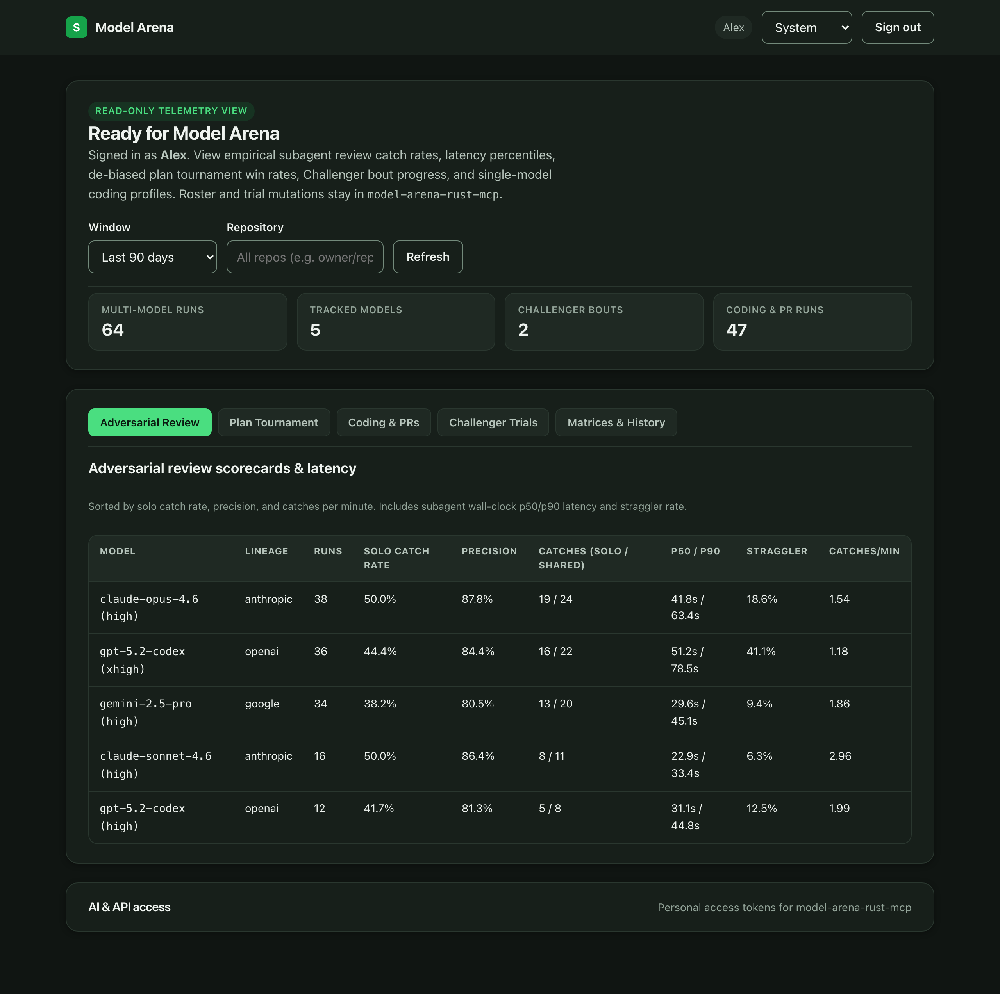
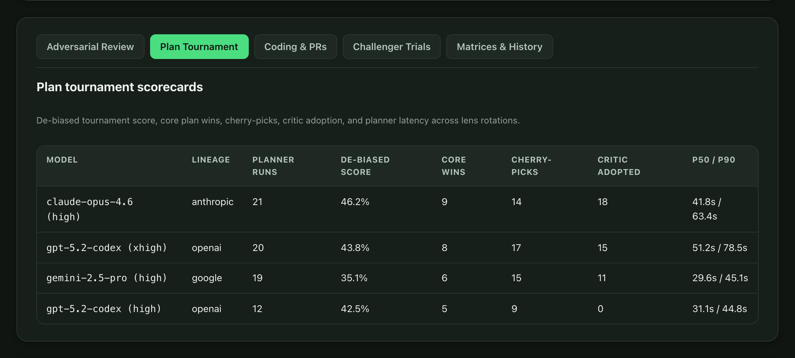
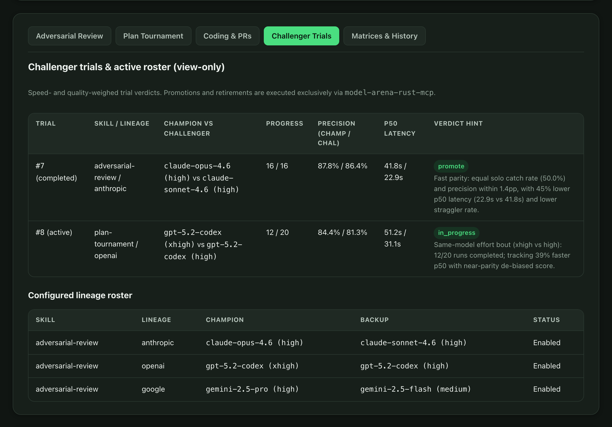
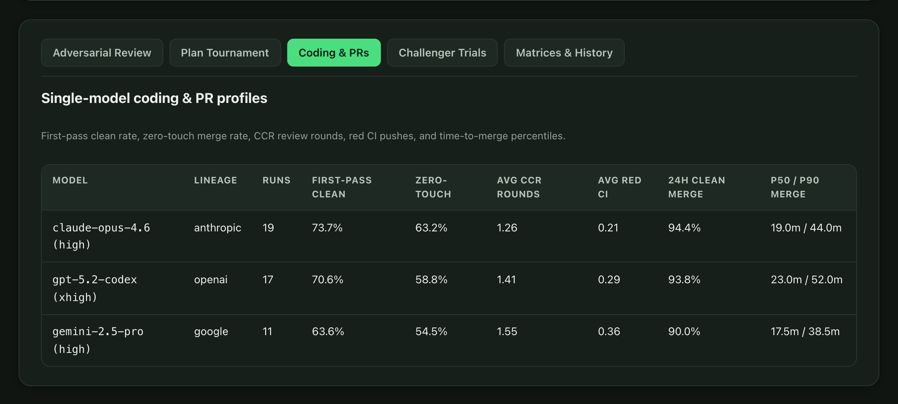

# Model Arena

Stop picking AI models on vibes. Track how they actually perform on your own code, de-bias the prompts, measure who's holding up the group, and make challengers earn their spot in the ring.

I built **Model Arena** as a self-hosted homelab dashboard and local `stdio` MCP server (`model-arena-rust-mcp`) in **Rust + Solid 2.0** to keep my multi-agent coding and review workflows honest.

## The problem I'm trying to solve

New models and reasoning-effort knobs drop every couple of weeks. Public leaderboards are fun to argue about on the internet, but they don't tell me whether a new model actually catches real bugs in *my* repos or just leaves five polite nitpicks while taking twice as long.

Without tracking real runs, I noticed myself falling into a few traps:

- **Vibes-based roster changes.** "Model X feels noisy lately" or "Model Y feels sluggish" usually just means I remember the last annoying run.
- **Hidden prompt bias.** When you run multiple models in parallel with different roles (like a "minimal diff" planner vs. an "edge cases" planner), a model can look brilliant or terrible just because of the role it got handed.
- **The parallel straggler tax.** When three subagents run in parallel, you wait for the slowest one. A model that's 2% smarter and 2x slower can quietly drag down every single review.
- **Home-team bias.** If a host model is triaging findings from subagents, does it secretly favor its own model family? I had no idea until I started measuring it.
- **Reasoning-effort guesswork.** Is `xhigh` actually catching more bugs than `high`, or am I just burning extra time and tokens for the same result?

Model Arena turns all of that into a lightweight, empirical feedback loop across every machine and agent harness I use.

## Screenshots

*(Captured with synthetic sample data so nobody's private repos or emails end up in git.)*

### Adversarial Review scorecards & latency
Tracks solo catch rate, precision, p50/p90 latency, straggler rate, and catches per minute per `(model, reasoning_effort)`.



### Plan Tournament scorecards
Macro-averaged win rates across rotated planning lenses, plus cherry-picked ideas and critic adoption.



### Challenger Trials & active lineage roster
Head-to-head Champion vs. Challenger bouts (including same-model reasoning-effort bouts like `xhigh` vs. `high`) with speed-and-quality verdict hints.



### Single-model Coding & PR profiles
Tracks how individual models do end-to-end on real PRs: first-pass clean rate, zero-touch merges, review rounds, red CI pushes, and time-to-merge percentiles.



## How it works (the methodology)

The core loop is four steps: **Select -> Run -> Record -> Decide**.

1. **Select (`select_panel`).** Before a multi-agent review or planning pass starts, the agent asks Model Arena for the lineup. For adversarial reviews, PR diffs pull up to 3 reviewers across enabled lineages, while non-PR reviews exclude the known host lineage and pull up to 2. For plan tournaments, Arena fills all 3 planning lens slots by rotating round-robin through the enabled roster. Whenever a selected lineage has an active Challenger trial, Arena swaps the Challenger in on a configured percentage of eligible runs (default 50%, with PR diffs staying on the Champion unless the trial opts in with `allowPrDiff: true`).
2. **Run.** The agent runs those subagents in parallel, times each leg's wall-clock duration, and triages the results with evidence.
3. **Record (`record_run` / `record_coding_run`).** At the end of a run, the agent spools the telemetry locally (`queueOnly: true`) so it never blocks the conversation, then flushes in the background (`flush_spool`). When a Challenger bout hits its target run count, the server hands back the completed trial so the agent can mention it in chat.
4. **Decide (`decide_trial`, `set_roster`, `override_*`).** The web UI is intentionally **read-only**. I want a calm dashboard for looking at the numbers, while actual roster changes and promotions stay behind explicit MCP/CLI tool calls.

Here's what it actually measures under the hood:

### 1. Adversarial Review scorecards
- **Precision (`adopted / (adopted + set_aside)`):** How often a reviewer's findings survive evidence-based triage (or my human override).
- **Solo Catch Rate (`solo_adopted / runs`):** My favorite stat. Adopted findings (via host triage or my human override) where this model was the only successful reviewer proposing that finding in the run.
- **Approach Pivots:** How often a model's finding actually changes the overall verdict on a plan or PR (`keep` -> `adjust` or `rethink`).
- **Latency & Straggler Rate:** Pools eligible timed durations per `(model, reasoning_effort)` across the selected runs to report p50/p90 latency, and tracks straggler rate across parallel fanouts with at least two successful timed competing legs (ignoring ties where every leg finishes in the same duration).

### 2. De-biased Plan Tournaments
When three planners tackle a problem under three different lenses (`minimal_diff`, `clean_architecture`, `edge_cases`), static assignments skew the scoreboard. Model Arena rotates lenses round-robin across the roster and computes a **de-biased tournament score**: for each lens with recorded runs, it takes `win_rate + min(cherry_picks / runs, 3.0) * 0.15`, then averages across the lenses observed so sparse history doesn't tank a model unfairly. It also tracks **cherry-picks** (good ideas rescued from a non-winning plan) and **critic value vs. bloat** (adopted critic amendments vs. speculative stuff we dropped).

### 3. Interaction matrices
Under **Matrices & History**, two tables keep the whole setup honest:
- **Lens x Model matrix:** Shows whether a model shines as an edge-case hunter vs. a minimal-diff planner.
- **Host Judge x Proposer matrix:** Shows adoption rates sliced by `(host_model, host_effort)` vs. `(reviewer_model, reviewer_effort)` so self-preference bias has nowhere to hide.

### 4. Bounded Champion vs. Challenger bouts (with speed guards)
Instead of swapping a Champion on a whim, I start a bounded trial (`start_trial`) for N runs (usually 15-20) inside one lineage slot. You can pit two different models against each other *or* pit the same model against itself at two different reasoning efforts (`xhigh` vs. `high`).

Trial verdict hints weigh both quality and speed:
- **Fast Parity Promotion:** If a Challenger matches quality within a tight tolerance (reviews: solo catch rate within `-2pp` and precision within `-3pp`, tournaments: de-biased score within `-0.02`), cuts p50 latency by at least 25%, stays within `+5pp` of the Champion's straggler rate, and doesn't add failures, it gets a `promote` hint.
- **Slow-Challenger Guard:** If a Challenger is at least `1.5x` slower on p50 latency, a modest quality bump (`< +15pp` solo catch and precision on reviews, or `< +0.20` de-biased score on tournaments) gets downgraded to `close_call` with a latency warning. If it's `1.5x` slower without clearly beating quality (`<= +2pp` solo catch and `<= +3pp` precision on reviews, or `<= +0.02` on tournaments), Arena suggests `retire`.

When you promote a winner (`decide_trial`), Arena atomically shifts the old Champion to Backup and moves the Challenger into the Champion seat.

### 5. Single-model Coding & PR profiles
Multi-agent reviews are only half the story. Model Arena also tracks single-model PR runs (`record_coding_run`) bucketed by diff size (`S`: `< 50` LOC, `M`: `50-250` LOC, `L`: `> 250` LOC) and task kind (`feature`, `bugfix`, `refactor`, `cleanup`, `other`). It tracks user steering turns, first-pass clean rate, zero-touch merges, automated review rounds, red CI pushes, time-to-green / time-to-merge percentiles, 24-hour clean merges, and escaped regressions.

### 6. Human ground-truth overrides
Host triage is a fast proxy, not gospel. If an adopted finding later turns out to be bogus, or a dismissed warning turns out to be a real bug, `override_candidate` and `override_coding_run` let me mark it `confirmed` or `overturned` and immediately recalculate precision, solo catches, and coding cleanliness scores. Replaying or backfilling a run preserves overrides for candidates whose `candidate_key` stays the same (either an explicit key or the generated hash of normalized summary + sorted proposing models), while omitted or re-keyed candidates drop their old overrides.

## Tech Stack

- **Backend:** Rust 2024 (`1.95+`), Axum `0.8`, SQLx `0.8` (PostgreSQL `18`), `utoipa` OpenAPI `3.1`, Argon2id cookie sessions + `pat_` personal access tokens, `rust-embed` single-binary SPA serving.
- **Frontend:** Solid `2.0`, Vite `8`, Vitest `5`, Bun `1.3`, `openapi-fetch` + `openapi-typescript`.
- **MCP Server:** `model-arena-rust-mcp` (`rmcp` over local `stdio`) with offline spooling and historical session backfill (`backfill_sessions`), reading credentials from `~/.config/model-arena-rust.json` or `MCP_APP_URL` / `MCP_APP_TOKEN`.
- **Deployment:** Nonroot distroless container (`ghcr.io/robert-crandall/model-arena-rust:main`) with built-in healthcheck.

Architecture notes live in [`docs/tech-stack.md`](docs/tech-stack.md) and the full product charter is in [`PRODUCT.md`](PRODUCT.md).

## Local Development

Prerequisites: Rust `1.95+`, Bun `1.3+`, and PostgreSQL `18+`.

```bash
# 1. Install frontend packages, initialize .env, and build web/build once
make setup

# 2. Point DATABASE_URL in .env at a local Postgres database, then start HMR + API
make dev
```

Vite serves on `http://localhost:5173` and proxies `/api` and `/healthz` to the Rust server on `http://127.0.0.1:8080`.

### Useful Make Targets

- `make spec` - regenerate `docs/openapi.json` and `web/src/lib/api/schema.d.ts` from Rust route definitions.
- `make check` - run `cargo fmt --check`, `cargo clippy --all-targets -- -D warnings`, and `tsc --noEmit`.
- `make test` - run Rust tests (`TEST_DATABASE_URL` enables Postgres integration tests) and frontend Vitest tests.
- `make build` - produce the standalone release binary at `bin/model-arena-rust`.

## Local MCP Server (`model-arena-rust-mcp`)

Install the binary into `~/bin`, sign in once to mint a personal access token (saved with `0600` permissions to `~/.config/model-arena-rust.json`), and print the MCP client config snippet:

```bash
make install-mcp
make mcp-token
make mcp-config
```

## Homelab Deployment (Docker Compose)

```yaml
services:
  model-arena-rust:
    image: ghcr.io/robert-crandall/model-arena-rust:main
    restart: unless-stopped
    ports:
      - "8080:8080"
    environment:
      DATABASE_URL: postgres://model_arena_rust:${POSTGRES_PASSWORD}@db:5432/model_arena_rust?sslmode=disable
      ADDR: ":8080"
      # Put HTTPS termination in front when setting APP_ENV=production;
      # leave APP_ENV unset when serving plain HTTP on a trusted LAN.
      APP_ENV: production
      ALLOW_OPEN_REGISTRATION: "true"
    depends_on:
      db:
        condition: service_healthy

  db:
    image: postgres:18
    restart: unless-stopped
    environment:
      POSTGRES_USER: model_arena_rust
      POSTGRES_PASSWORD: ${POSTGRES_PASSWORD}
      POSTGRES_DB: model_arena_rust
    volumes:
      - pgdata:/var/lib/postgresql
    healthcheck:
      test: ["CMD-SHELL", "pg_isready -U model_arena_rust"]
      interval: 10s
      retries: 5

volumes:
  pgdata:
```

- **TLS vs. trusted-LAN HTTP:** `APP_ENV=production` marks the `model_arena_rust_session` cookie `Secure`, so browsers (and `model-arena-rust-mcp token` against an `http://` URL) drop it over plain HTTP. Put TLS termination in front of the container in production (preserving the incoming `Host` header, e.g., `proxy_set_header Host $host` in `nginx`, so same-origin CSRF checks match `Origin`), or leave `APP_ENV` unset when accessing `http://<homelab-ip>:8080` directly on a trusted home network.
- **Account sign-up:** Flip `ALLOW_OPEN_REGISTRATION=false` once your accounts are created to lock new sign-ups.

